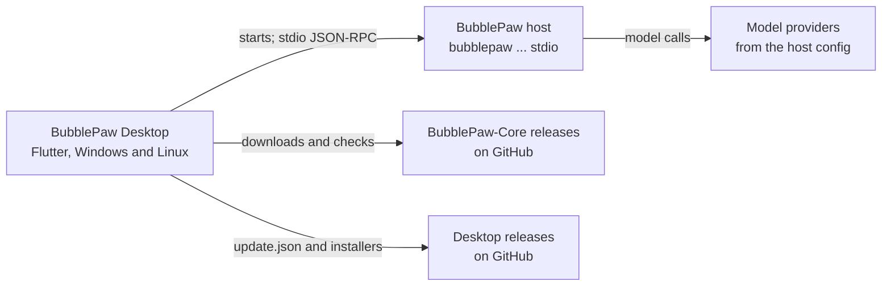

<!-- lockup: design/readme/wordmark.py, glyph assets/icon/tray/tray.svg, Bricolage Grotesque (assets/fonts) -->
<p align="center">
  <picture>
    <source media="(prefers-color-scheme: dark)" srcset="design/readme/bubblepaw-desktop-dark.svg">
    
  </picture>
</p>

<p align="center">
  Desktop app (Windows and Linux) for BubblePaw. It holds almost no UI of its own:
  it composes the <a href="https://github.com/BubbleBuffer/agent-kit">BubbleBuffer agent kit</a>
  (<code>AgentWorkbench</code>: session rail, header, transcript, composer, approvals, diffs)
  over a BubblePaw host that runs as a child process.
</p>

Version 0.1. The wiki is in [`docs/`](docs/README.md).

<!-- hero screenshot: later -->

## What it is

- **Chat with a BubblePaw agent.** Chats run in the agent kit's workbench: the session list, the transcript, the composer, approvals, and a diff review for edits.
- **A host it starts for you.** The app runs `bubblepaw --workspace <dir> --data-dir <dir> stdio` as a child process and talks to it over stdio. Switching workspace starts a new host. A failed or stopped host shows a notice with Restart and Settings.
- **Core, downloaded or installed.** On first run it downloads the newest BubblePaw-Core release in range and checks it against the release's `SHA256SUMS`. It can also run a Core already installed on the computer, or a custom binary.
- **Settings.** General (theme, start at login, tray), Core, Models (the host's providers and default model; keys are never shown), About (versions, updates and licences), and Feedback.
- **Local feedback.** Ctrl+Shift+F opens a sheet that saves a report, a screenshot and redacted diagnostics in a folder on this computer. Nothing is sent anywhere.
- **Tray and background.** A tray menu with Open BubblePaw, the host's status, the number of chats waiting for you, Restart host and Quit. With "Keep running in the tray" on, closing the window hides it.
- **App updates.** The Stable and Nightly channels read `update.json` manifests from GitHub Releases, and each download is checked against its SHA-256. Windows updates run the Inno installer. On Linux the app shows where the tarball is.

## How it fits together



| Package | Path | What it does |
| --- | --- | --- |
| `bubblepaw_desktop` | [`lib/`](lib) | The desktop app shell for BubblePaw on the agent kit: Core, the host's lifetime, settings, tray, feedback, updates |
| `agent_kit` | [`packages/agent_kit`](https://github.com/BubbleBuffer/agent-kit/tree/af5b27f3fb9009aaf23fa5807f28fdc9c74b9174/packages/agent_kit) | Flutter widgets for the agent kit: theme, status, transcript, composer, chrome, workspace |
| `agent_kit_core` | [`packages/agent_kit_core`](https://github.com/BubbleBuffer/agent-kit/tree/af5b27f3fb9009aaf23fa5807f28fdc9c74b9174/packages/agent_kit_core) | Pure Dart agent UI core: view models, the `AgentBackend` port, the event reducer and a scripted fake backend |
| `agent_kit_bubblepaw` | [`packages/agent_kit_bubblepaw`](https://github.com/BubbleBuffer/agent-kit/tree/af5b27f3fb9009aaf23fa5807f28fdc9c74b9174/packages/agent_kit_bubblepaw) | Pure Dart BubblePaw stdio JSON-RPC backend for the agent kit |
| `bb_ui` | [`packages/bb_ui`](https://github.com/BubbleBuffer/bb-ui/tree/v0.6.0/packages/bb_ui) | BubbleBuffer UI primitives for Flutter without Material |

## Build

CI ([`.github/workflows/ci.yml`](.github/workflows/ci.yml)) runs on GitHub-hosted `ubuntu-latest` with Flutter **3.47.7** on the stable channel. The Linux build also needs `clang cmake ninja-build pkg-config libgtk-3-dev libayatana-appindicator3-dev` from apt.

The live check runs against BubblePaw-Core **v0.3.1**. CI downloads `bubblepaw-v0.3.1-x86_64-unknown-linux-gnu.tar.gz` and `SHA256SUMS` from that release, verifies the archive with `sha256sum -c`, extracts it, and points `BP_TEST_BIN` at the `bubblepaw` binary. The Core range the app accepts is `>=0.3.1 <0.5.0` (`lib/src/semver.dart`).

```sh
flutter pub get
dart format --output=none --set-exit-if-changed lib test
flutter analyze
flutter test --exclude-tags golden                             # unit and widget tests, scripted backend
flutter test --tags golden                                     # compares test/goldens/*.png (rendered on Linux)
BP_TEST_BIN=/path/to/bubblepaw flutter test --tags live test/live_test.dart
flutter build linux --debug
```

**Run it.** Scripted mode runs the kit's fake backend and needs no BubblePaw binary: `flutter run -d linux --dart-entrypoint-args=--scripted`, or `bubblepaw_desktop --scripted` for a built app. Real mode is `flutter run -d linux`; on first run the app downloads Core, and Settings > Core shows what it is using.

Config is `config.json` in the app-support directory: `%APPDATA%\BubblePaw Desktop` on Windows, or `$XDG_DATA_HOME/bubblepaw-desktop` (else `~/.local/share/bubblepaw-desktop`) on Linux. `--config-dir <dir>` replaces that directory for one launch. The app's own preferences are in `preferences.json` beside it. Release builds and the Windows installer are described in [docs/releases.md](docs/releases.md).

## Licence

`AGPL-3.0`; see [LICENSE](LICENSE). The bundled fonts (Atkinson Hyperlegible Next, Bricolage Grotesque, Fragment Mono) are under the SIL Open Font License 1.1, in [`assets/fonts/licenses/`](assets/fonts/licenses). Settings > About > Licences lists the licence of each package the app ships.

BubblePaw Desktop is made by [BubbleBuffer](https://0xbubbuff.de).
