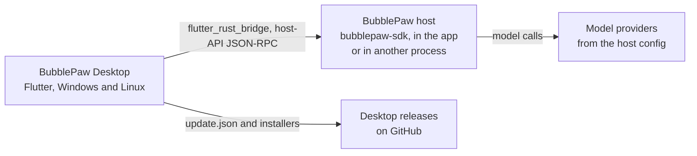

<!-- lockup: design/readme/wordmark.py, glyph assets/icon/tray/tray.svg, Bricolage Grotesque (assets/fonts) -->
<p align="center">
  <picture>
    <source media="(prefers-color-scheme: dark)" srcset="design/readme/bubblepaw-desktop-dark.svg">
    
  </picture>
</p>

<p align="center">
  Desktop app (Windows and Linux) for BubblePaw. It holds almost no UI of its own:
  it composes the <a href="https://github.com/BubbleBuffer/agent-kit">BubbleBuffer agent kit</a>
  (<code>AgentWorkbench</code>: session rail, header, transcript, composer, approvals, diffs)
  over a BubblePaw host that runs inside the app (BubblePaw Core, embedded through Rust).
</p>

Version 0.1. The wiki is in [`docs/`](docs/README.md).

<!-- hero screenshot: later -->

## What it is

- **Chat with a BubblePaw agent.** Chats run in the agent kit's workbench: the session list, the transcript, the composer, approvals, and a diff review for edits.
- **A host inside the app.** Core is linked into the app as a Rust library (`native/`, on `bubblepaw-sdk`) and reached through flutter_rust_bridge. If a BubblePaw host is already running on the same data directory, the app attaches to it; otherwise it embeds one. Switching workspace starts a new host. A failed or stopped host shows a notice with Restart and Settings.
- **Settings.** General (theme, start at login, tray), Models (the host's providers and default model; keys are never shown), About (versions, updates and licences), and Feedback.
- **Local feedback.** Ctrl+Shift+F opens a sheet that saves a report, a screenshot and redacted diagnostics in a folder on this computer. Nothing is sent anywhere.
- **Tray and background.** A tray menu with Open BubblePaw, the host's status, the number of chats waiting for you, Restart host and Quit. With "Keep running in the tray" on, closing the window hides it.
- **App updates.** The Stable and Nightly channels read `update.json` manifests from GitHub Releases, and each download is checked against its SHA-256. Windows updates run the Inno installer. On Linux the app shows where the tarball is.

## How it fits together



| Package | Path | What it does |
| --- | --- | --- |
| `bubblepaw_desktop` | [`lib/`](lib) | The desktop app shell for BubblePaw on the agent kit: the host's lifetime, settings, tray, feedback, updates |
| `agent_kit` | [`packages/agent_kit`](https://github.com/BubbleBuffer/agent-kit/tree/2359ce71341bf5f5c73c5e722a340d26f6fe9019/packages/agent_kit) | Flutter widgets for the agent kit: theme, status, transcript, composer, chrome, workspace |
| `bubblepaw_desktop_native` | [`native/`](native) | Rust crate on `bubblepaw-sdk` (Core `v0.5.0`): open, call, notifications and close, as JSON-RPC text. [`rust_builder/`](rust_builder) is the Cargokit glue that builds it with the app |
| `agent_kit_core` | [`packages/agent_kit_core`](https://github.com/BubbleBuffer/agent-kit/tree/2359ce71341bf5f5c73c5e722a340d26f6fe9019/packages/agent_kit_core) | Pure Dart agent UI core: view models, the `AgentBackend` port, the event reducer and a scripted fake backend |
| `agent_kit_bubblepaw` | [`packages/agent_kit_bubblepaw`](https://github.com/BubbleBuffer/agent-kit/tree/2359ce71341bf5f5c73c5e722a340d26f6fe9019/packages/agent_kit_bubblepaw) | Pure Dart BubblePaw stdio JSON-RPC backend for the agent kit |
| `bb_ui` | [`packages/bb_ui`](https://github.com/BubbleBuffer/bb-ui/tree/v0.6.0/packages/bb_ui) | BubbleBuffer UI primitives for Flutter without Material |

## Build

You need Flutter **3.47.7** (stable) and a Rust toolchain (stable, installed with rustup): Core is compiled into the app, so `flutter build` and `flutter run` run `cargo` through Cargokit. The first build fetches and compiles `bubblepaw-sdk` and is slow. On Linux the build also needs `clang cmake ninja-build pkg-config libgtk-3-dev libayatana-appindicator3-dev`; on Windows, Visual Studio with the C++ desktop workload. `native/target` and `build/` can be pointed at another disk with a directory junction or symlink.

CI ([`.github/workflows/ci.yml`](.github/workflows/ci.yml)) runs on GitHub-hosted `ubuntu-latest` and `windows-latest`. Linux: format, analyze, tests, goldens, the crate's fmt, Clippy and tests, the FFI transport test against the built crate, and a debug build. Windows: the crate's tests, the same FFI test and a debug build.

The embedded Core is `bubblepaw-sdk` at tag `v0.5.0` (`native/Cargo.toml`; `CORE_VERSION` in `native/src/lib.rs` must match, and a test checks it). The Dart bindings in `lib/src/rust/` and `native/src/frb_generated.rs` are generated and committed: after changing `native/src/api/`, run `flutter_rust_bridge_codegen generate` (version 2.13.0, the same as the `flutter_rust_bridge` package).

```sh
flutter pub get
dart format --output=none --set-exit-if-changed lib test
flutter analyze
flutter test --exclude-tags "golden || native"   # unit and widget tests, scripted backend
flutter test --tags golden                       # compares test/goldens/*.png (rendered on Linux)
cargo test --manifest-path native/Cargo.toml     # the crate: session.list, attach, errors
cargo build --manifest-path native/Cargo.toml && flutter test --tags native test/native_host_test.dart
flutter build linux --debug
```

**Run it.** Scripted mode runs the kit's fake backend and does not start Core: `flutter run -d linux --dart-entrypoint-args=--scripted`, or `bubblepaw_desktop --scripted` for a built app. Real mode is `flutter run -d linux`; on first run the app saves default directories, starts the embedded host and opens Settings, and Settings > About shows the Core version it embeds.

Config is `config.json` in the app-support directory: `%APPDATA%\BubblePaw Desktop` on Windows, or `$XDG_DATA_HOME/bubblepaw-desktop` (else `~/.local/share/bubblepaw-desktop`) on Linux. `--config-dir <dir>` replaces that directory for one launch. The app's own preferences are in `preferences.json` beside it. Release builds and the Windows installer are described in [docs/releases.md](docs/releases.md).

## Licence

`AGPL-3.0`; see [LICENSE](LICENSE). The bundled fonts (Atkinson Hyperlegible Next, Bricolage Grotesque, Fragment Mono) are under the SIL Open Font License 1.1, in [`assets/fonts/licenses/`](assets/fonts/licenses). Settings > About > Licences lists the licence of each package the app ships.

BubblePaw Desktop is made by [BubbleBuffer](https://0xbubbuff.de).
